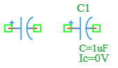

.. _capacitor_ic_element:

Capacitor with Initial Condition
================================

The **Capacitor with Initial Condition** is a specialized variant of the standard capacitor in the DSpice Basic library. It allows users to define an initial voltage across the capacitor at the start of a transient simulation. This element is essential for analyzing circuits with pre-charged capacitors, energy storage systems, and transient response studies. It leverages the ngspice capacitor model with the ``IC`` parameter.

Symbol
------

The schematic symbol for the Capacitor with Initial Condition follows the IEEE/ANSI standard representation for a polarized capacitor. It features two parallel plates with a polarity indicator (+) on the positive terminal.

Description
-----------

A capacitor with initial condition stores electrical energy in an electric field and starts the simulation with a predefined voltage across its terminals. This is particularly useful for modeling real-world scenarios where capacitors are pre-charged before a circuit is activated. Key characteristics include:

- **Pre-charged State:** Starts simulation with a specified initial voltage, representing a capacitor that has been charged prior to t=0.
- **Polarized Symbol:** The (+) indicator shows the positive terminal, important for electrolytic capacitors that must be connected with correct polarity.
- **Transient Analysis:** Critical for accurate transient simulations where initial conditions affect circuit behavior.
- **Energy Storage:** Initial voltage represents stored energy: E = ½ C × V²_IC.

The capacitor with initial condition is essential for power-up simulations, energy storage analysis, and circuits where capacitors retain charge from previous operating states.

Netlist Format
--------------

In the SPICE netlist generated by DSpice, the capacitor with initial condition is represented using the following syntax:

.. code-block:: text

   C<name> <node+> <node-> <value> IC=<voltage>

Where:

- ``C<name>``: Unique identifier starting with 'C' (e.g., C1, C_FILTER, C_STORAGE).
- ``<node+>``: Positive terminal node number or name.
- ``<node->``: Negative terminal node number or name.
- ``<value>``: Capacitance value in Farads. Suffixes like 'u' (micro), 'n' (nano), 'p' (pico), or 'f' (femto) are supported.
- ``IC=<voltage>``: Initial condition specifying the voltage across the capacitor at time t=0 in Volts.

Examples
~~~~~~~~

**Example 1: Pre-charged Capacitor**

The image above shows a capacitor configured with ``C=1uF`` and ``Ic=0V``:

.. code-block:: text

   C1 1 0 1u IC=0

This represents:
- **Capacitance:** 1 µF
- **Initial Voltage:** 0 V (uncharged capacitor at start)
- **Application:** Standard decoupling capacitor starting from discharged state

**Example 2: Pre-charged Energy Storage**

.. code-block:: text

   C_STORAGE vdd gnd 100u IC=12

This represents:
- **Capacitance:** 100 µF
- **Initial Voltage:** 12 V (pre-charged to 12V)
- **Stored Energy:** E = ½ × 100µ × 12² = 7.2 mJ
- **Application:** Modeling a capacitor that retains charge from a previous power cycle

**Example 3: Filter Capacitor with Bias**

.. code-block:: text

   C_FILTER in out 10n IC=2.5

This represents:
- **Capacitance:** 10 nF
- **Initial Voltage:** 2.5 V (biased to mid-supply)
- **Application:** AC coupling capacitor in single-supply amplifier circuits

The voltage across the capacitor during transient analysis starts from:

.. math::

   V_C(0) = V_{IC}

And evolves according to:

.. math::

   V_C(t) = V_{IC} + \frac{1}{C} \int_0^t I_C(\tau) d\tau

Where :math:`I_C(t)` is the current flowing through the capacitor.

This format ensures full compatibility with ngspice and allows seamless integration into larger circuit netlists.

Advanced Parameters & Symbol Modification
-----------------------------------------

DSpice supports advanced simulation studies through optional parameters that can be added directly to the component symbol. This feature allows users to customize component behavior without altering the global model library.

Modifying Initial Condition
~~~~~~~~~~~~~~~~~~~~~~~~~~~

To perform transient analysis with specific starting conditions, you can modify the Capacitor Ic symbol to expose the ``IC`` parameter:

1. **Open Symbol Editor:** Right-click the Capacitor Ic symbol in your schematic and select "Edit Symbol" or access it via the Basic library manager.
2. **Add Parameter:** In the symbol properties panel, ensure the ``IC`` parameter field is visible and editable.
3. **Map to Netlist:** Ensure this parameter is mapped to the SPICE ``IC`` attribute in the netlist generation settings.
4. **Save & Use:** Save the modified symbol. When placed in a schematic, you can now enter a specific initial voltage directly in the component's property dialog.

Adding Temperature Coefficients
~~~~~~~~~~~~~~~~~~~~~~~~~~~~~~~

For advanced temperature-dependent analysis, you can also add ``TC1`` and ``TC2`` parameters:

1. **Open Symbol Editor:** Access the symbol properties panel.
2. **Add Parameters:** Add new parameter fields named ``TC1`` and ``TC2``.
3. **Map to Netlist:** Map these to the SPICE ``TC`` attribute.

The capacitance at temperature *T* becomes:

.. math::

   C(T) = C_{nominal} \times [1 + TC1 \times (T - T_{nom}) + TC2 \times (T - T_{nom})^2]

Use Cases
~~~~~~~~~

- **Power-Up Simulation:** Modeling circuits where capacitors start with residual charge from previous operation.
- **Energy Storage Systems:** Analyzing supercapacitors or battery backup circuits with known initial charge levels.
- **Single-Supply Amplifiers:** Setting coupling capacitors to mid-supply bias voltage (e.g., 2.5V for a 5V system).
- **Transient Recovery:** Studying how circuits recover from power interruptions when capacitors retain charge.
- **Sample-and-Hold Circuits:** Modeling capacitors that hold sampled voltage values in ADC circuits.
- **Bootstrapping Circuits:** Analyzing circuits where capacitors are pre-charged to enable voltage boosting.

.. note::
   The ``IC`` parameter only affects transient (.TRAN) analysis. For DC operating point (.OP) analysis, the capacitor is treated as an open circuit regardless of the initial condition.
