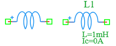

.. _inductor_ic_element:

Inductor with Initial Condition
===============================

The **Inductor with Initial Condition** is a specialized variant of the standard inductor in the DSpice Basic library. It allows users to define an initial current flowing through the inductor at the start of a transient simulation. This element is essential for analyzing circuits with pre-energized inductors, magnetic energy storage systems, and transient response studies. It leverages the ngspice inductor model with the ``IC`` parameter.

Symbol
------

The schematic symbol for the Inductor with Initial Condition follows the IEEE/ANSI standard representation with a series of loops or coils. It features a polarity indicator (+) on the positive terminal.

Description
-----------

An inductor with initial condition stores electrical energy in a magnetic field and starts the simulation with a predefined current flowing through it. This is particularly useful for modeling real-world scenarios where inductors carry current before a circuit is activated or switched. Key characteristics include:

- **Pre-energized State:** Starts simulation with a specified initial current, representing an inductor that has been energized prior to t=0.
- **Polarity Indicator:** The (+) indicator shows the reference terminal for current direction, important for coupled inductors and transformer modeling.
- **Transient Analysis:** Critical for accurate transient simulations where initial conditions affect circuit behavior, especially in switching power supplies.
- **Energy Storage:** Initial current represents stored magnetic energy: E = ½ L × I²_IC.

The inductor with initial condition is essential for power-up simulations, magnetic energy storage analysis, and circuits where inductors retain current from previous operating states.

Netlist Format
--------------

In the SPICE netlist generated by DSpice, the inductor with initial condition is represented using the following syntax:

.. code-block:: text

   L<name> <node+> <node-> <value> IC=<current>

Where:

- ``L<name>``: Unique identifier starting with 'L' (e.g., L1, L_FILTER, L_STORAGE).
- ``<node+>``: Positive terminal node number or name (reference terminal for current direction).
- ``<node->``: Negative terminal node number or name.
- ``<value>``: Inductance value in Henrys. Suffixes like 'm' (milli), 'u' (micro), or 'n' (nano) are supported.
- ``IC=<current>``: Initial condition specifying the current flowing through the inductor at time t=0 in Amperes.

Examples
~~~~~~~~

**Example 1: De-energized Inductor**

The image above shows an inductor configured with ``L=1mH`` and ``Ic=0A``:

.. code-block:: text

   L1 1 2 1m IC=0

This represents:
- **Inductance:** 1 mH
- **Initial Current:** 0 A (de-energized inductor at start)
- **Application:** Standard filter inductor starting from zero current state

**Example 2: Pre-energized Energy Storage**

.. code-block:: text

   L_STORAGE vdd out 100u IC=2

This represents:
- **Inductance:** 100 µH
- **Initial Current:** 2 A (pre-energized to 2A)
- **Stored Energy:** E = ½ × 100µ × 2² = 200 µJ
- **Application:** Modeling an inductor that retains current from a previous switching cycle in a DC-DC converter

**Example 3: Filter Inductor with Bias Current**

.. code-block:: text

   L_FILTER in out 10u IC=0.5

This represents:
- **Inductance:** 10 µH
- **Initial Current:** 0.5 A (biased current)
- **Application:** Output filter inductor in a buck converter operating in continuous conduction mode

The current through the inductor during transient analysis starts from:

.. math::

   I_L(0) = I_{IC}

And evolves according to:

.. math::

   I_L(t) = I_{IC} + \frac{1}{L} \int_0^t V_L(\tau) d\tau

Where :math:`V_L(t)` is the voltage across the inductor.

This format ensures full compatibility with ngspice and allows seamless integration into larger circuit netlists.

Advanced Parameters & Symbol Modification
-----------------------------------------

DSpice supports advanced simulation studies through optional parameters that can be added directly to the component symbol. This feature allows users to customize component behavior without altering the global model library.

Modifying Initial Condition
~~~~~~~~~~~~~~~~~~~~~~~~~~~

To perform transient analysis with specific starting conditions, you can modify the Inductor Ic symbol to expose the ``IC`` parameter:

1. **Open Symbol Editor:** Right-click the Inductor Ic symbol in your schematic and select "Edit Symbol" or access it via the Basic library manager.
2. **Add Parameter:** In the symbol properties panel, ensure the ``IC`` parameter field is visible and editable.
3. **Map to Netlist:** Ensure this parameter is mapped to the SPICE ``IC`` attribute in the netlist generation settings.
4. **Save & Use:** Save the modified symbol. When placed in a schematic, you can now enter a specific initial current directly in the component's property dialog.

Adding Series Resistance (Rser)
~~~~~~~~~~~~~~~~~~~~~~~~~~~~~~~

For modeling real-world inductors with winding resistance, you can also add the ``Rser`` parameter:

1. **Open Symbol Editor:** Access the symbol properties panel.
2. **Add Parameter:** Add a new parameter field named ``Rser``.
3. **Map to Netlist:** Map this to the SPICE ``Rser`` attribute.

The effective voltage across the inductor becomes:

.. math::

   V_L(t) = L \frac{dI_L}{dt} + I_L(t) \times R_{ser}

Use Cases
~~~~~~~~~

- **Switching Power Supplies:** Modeling inductors in buck, boost, and flyback converters that operate in continuous conduction mode with non-zero initial current.
- **Magnetic Energy Storage:** Analyzing inductors that retain energy from previous switching cycles.
- **Motor Drive Simulation:** Modeling motor windings with initial current from previous operation.
- **Transient Recovery:** Studying how circuits recover from power interruptions when inductors retain current.
- **Coupled Inductor Modeling:** Setting initial conditions for transformer primary or secondary windings.
- **Current-Mode Control:** Analyzing circuits where inductor current is used as a feedback signal.

.. note::
   The ``IC`` parameter only affects transient (.TRAN) analysis. For DC operating point (.OP) analysis, the inductor is treated as a short circuit regardless of the initial condition.