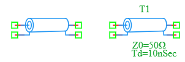

.. _tline_element:

Transmission Line
=================

The **Transmission Line** is a specialized two-port passive component in the DSpice Basic library. It models an ideal lossless transmission line used for high-frequency signal propagation, delay lines, and impedance matching. It is defined by its characteristic impedance and time delay. It leverages the ngspice ``T`` element model.

Symbol
------

The schematic symbol for the Transmission Line represents a cylindrical cable or trace. It features **four connection terminals** marked by green squares: two for the input port (left side) and two for the output port (right side). The symbol displays the component name (e.g., T1), characteristic impedance (Z0), and time delay (Td).

Description
-----------

A Transmission Line models the propagation of electrical signals along a conductor with a specific characteristic impedance and propagation delay. Unlike simple RLC components, it accounts for the finite speed of signal travel, which is critical in high-frequency and high-speed digital designs. Key characteristics include:

- **Two-Port Device:** Has an input port (2 terminals) and an output port (2 terminals).
- **Characteristic Impedance (Z0):** The intrinsic impedance of the line, determining how voltage and current waves propagate.
- **Time Delay (Td):** The time it takes for a signal to travel from the input to the output.
- **Lossless Model:** The ideal model assumes no resistance or conductance losses (pure delay and impedance transformation).
- **Reflection Handling:** Accurately models signal reflections when the line is not terminated in its characteristic impedance.

The Transmission Line is essential for RF design, high-speed digital signaling, antenna feed lines, and delay line applications.

Netlist Format
--------------

In the SPICE netlist generated by DSpice, the Transmission Line is represented using the following syntax:

.. code-block:: text

   T<name> <in+> <in-> <out+> <out-> Z0=<value> TD=<value>

Where:

- ``T<name>``: Unique identifier starting with 'T' (e.g., T1, T_LINE, T_DELAY).
- ``<in+>``: Positive input terminal node number or name.
- ``<in->``: Negative input terminal node number or name (usually ground).
- ``<out+>``: Positive output terminal node number or name.
- ``<out->``: Negative output terminal node number or name (usually ground).
- ``Z0=<value>``: Characteristic impedance in Ohms (Ω).
- ``TD=<value>``: Time delay in seconds (s). Suffixes like 'n' (nano), 'p' (pico) are supported.

Examples
~~~~~~~~

**Example 1: Basic 50Ω Delay Line**

The image above shows a Transmission Line configured with ``Z0=50Ω`` and ``Td=10nSec``:

.. code-block:: text

   T1 in+ in- out+ out- Z0=50 TD=10n

This represents:
- **Characteristic Impedance:** 50 Ω (standard for RF and coaxial cables)
- **Time Delay:** 10 ns (signal takes 10 nanoseconds to travel from input to output)
- **Physical Length Equivalent:** For a signal propagating at ~2×10⁸ m/s (typical in PCB), this corresponds to approximately 2 meters of cable.

**Example 2: 75Ω Video Cable**

.. code-block:: text

   T_VIDEO source gnd load gnd Z0=75 TD=50n

This represents:
- **Characteristic Impedance:** 75 Ω (standard for video and antenna cables)
- **Time Delay:** 50 ns
- **Application:** Modeling a coaxial cable connecting a video source to a load

**Example 3: Differential Pair Delay**

.. code-block:: text

   T_DIFF inp inn outp outn Z0=100 TD=2n

This represents:
- **Characteristic Impedance:** 100 Ω (standard for differential pairs like USB, Ethernet)
- **Time Delay:** 2 ns
- **Application:** Modeling a differential trace on a PCB

The behavior of the transmission line is governed by the telegrapher's equations. For a lossless line, the voltage and current at the output are delayed versions of the input, modified by reflection coefficients if the load impedance (ZL) does not match Z0:

.. math::

   \Gamma = \frac{Z_L - Z_0}{Z_L + Z_0}

Where :math:`\Gamma` is the reflection coefficient. If :math:`Z_L = Z_0`, there are no reflections, and the signal is perfectly transferred with a delay of `Td`.

This format ensures full compatibility with ngspice and allows seamless integration into larger circuit netlists.

Advanced Parameters & Symbol Modification
-----------------------------------------

DSpice supports advanced simulation studies through optional parameters that can be added directly to the component symbol. This feature allows users to customize component behavior without altering the global model library.

Adding Frequency Parameter (F) and NL (Electrical Length)
~~~~~~~~~~~~~~~~~~~~~~~~~~~~~~~~~~~~~~~~~~~~~~~~~~~~~~~~~

Instead of specifying Time Delay (Td), you can define the line by its frequency (F) and electrical length (NL) in degrees:

1. **Open Symbol Editor:** Right-click the Transmission Line symbol in your schematic and select "Edit Symbol".
2. **Modify Parameters:** Replace ``TD`` with ``F`` (frequency in Hz) and ``NL`` (electrical length in degrees, default 90°).
3. **Map to Netlist:** Ensure these parameters are mapped correctly.

The relationship is:

.. math::

   T_d = \frac{NL}{360 \times F}

This is useful for designing stub filters and impedance matching networks at specific frequencies.

Use Cases
~~~~~~~~~

- **RF Impedance Matching:** Using transmission line stubs (open or short-circuited) to match impedances in RF amplifiers and antennas.
- **High-Speed Digital Design:** Modeling PCB traces to analyze signal integrity, reflections, and crosstalk.
- **Delay Lines:** Creating precise time delays for synchronization in radar, communications, and clock distribution.
- **Cable Modeling:** Simulating the behavior of coaxial, twisted pair, or ribbon cables in a system.
- **Filter Design:** Implementing distributed element filters (e.g., quarter-wave transformers) for microwave frequencies.
- **Antenna Feed Lines:** Modeling the connection between a transmitter and an antenna to ensure maximum power transfer.

.. note::
   The Transmission Line element in ngspice is **lossless** by default. It does not model series resistance (R) or shunt conductance (G). For lossy lines, a distributed RLCG model or a specialized lossy transmission line element (if supported) should be used.
   
   Ensure that the time step in your transient analysis (`.TRAN`) is significantly smaller than the Time Delay (Td) to accurately capture the propagation effects.