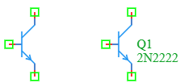

.. _bjt_npn_element:

NPN Bipolar Junction Transistor
================================

The **NPN Bipolar Junction Transistor** is a fundamental active semiconductor component in the DSpice Semiconductor library. It is a three-terminal device widely used for amplification, switching, and signal modulation. The NPN transistor is the most common type of BJT, distinguished by the outward-pointing arrow on its emitter terminal. It leverages the ngspice ``Q`` element with a referenced NPN model for accurate DC, AC, and transient analysis.

Symbol
------

The schematic symbol for the NPN BJT follows the IEEE/ANSI standard representation.

The symbol features **three connection terminals** marked by green squares:
- **Base (B):** Left terminal (control input).
- **Collector (C):** Top terminal (main current input).
- **Emitter (E):** Bottom terminal with the outward arrow (main current output).

The symbol displays the component name (e.g., Q1) and the model name (e.g., 2N2222).

Description
-----------

An NPN transistor is a current-controlled device where a small current flowing **into** the base terminal controls a larger current flowing from the collector to the emitter. Key characteristics include:

- **Three-Terminal Device:** Base (B), Collector (C), and Emitter (E).
- **Current Flow Direction:** Conventional current flows from collector to emitter (controlled by base current).
- **Base Current:** Flows **into** the base terminal.
- **Voltage Polarity:** Collector is at a higher potential than the emitter in normal active operation ($V_C > V_E$).
- **Current Amplification:** The collector current ($I_C$) is proportional to the base current ($I_B$), with the ratio defined by the DC current gain ($\beta$ or $h_{FE}$).
- **Operating Regions:** Cutoff (switch OFF), Active (linear amplification), and Saturation (switch ON).

The NPN transistor is essential for low-side switching, common-emitter amplification, current sinking, and analog signal processing.

Netlist Format
--------------

In the SPICE netlist generated by DSpice, the NPN BJT is represented using the following syntax:

.. code-block:: text

   Q<name> <collector> <base> <emitter> [<substrate>] <model_name> [area=<value>] [off] [IC=<Vbe>, <Vce>]

Where:

- ``Q<name>``: Unique identifier starting with 'Q' (e.g., Q1, Q_AMP, Q_SW).
- ``<collector>``: Collector terminal node number or name.
- ``<base>``: Base terminal node number or name.
- ``<emitter>``: Emitter terminal node number or name (usually connected to ground in low-side switches).
- ``[<substrate>]``: Optional substrate node (for integrated circuit models, usually omitted for discrete transistors).
- ``<model_name>``: Reference to an NPN BJT model defined with a ``.MODEL`` statement with type ``NPN`` (e.g., 2N2222, 2N3904).
- ``[area=<value>]``: Optional area factor (default: 1). Multiplies the model parameters to simulate larger or smaller transistors.
- ``[off]``: Optional keyword to set the initial state of the transistor to OFF for DC analysis.
- ``[IC=<Vbe>, <Vce>]``: Optional initial conditions specifying the base-emitter and collector-emitter voltages at time t=0 in Volts.

.. note::
   The NPN BJT model must be defined separately using a ``.MODEL`` statement with type ``NPN``. For example:
   
   .. code-block:: text
   
      .MODEL 2N2222 NPN (IS=1.41f BF=255.9 VAF=74.03 IKF=0.2847 XTB=1.5 BR=6.092 VAR=17.91 IKR=0 RB=1 CJC=7.306p MJC=0.3416 VJC=0.75 FC=0.5 CJE=22.01p MJE=0.377 VJE=0.75 TR=46.91n TF=411.1p ITF=1.761 VTF=13.32 XTF=417.1)

Examples
~~~~~~~~

**Example 1: Basic NPN Transistor**

The standard NPN configuration using the popular 2N2222 model:

.. code-block:: text

   Q1 collector base emitter 2N2222

This represents:
- **Component Name:** Q1
- **Collector:** Connected to node ``collector``
- **Base:** Connected to node ``base``
- **Emitter:** Connected to node ``emitter``
- **Model:** 2N2222 (general-purpose NPN transistor)

**Example 2: Low-Side Switch (Sinking Current)**

.. code-block:: text

   Q_SWITCH load gnd control 2N3904

This represents a classic low-side switch:
- **Collector:** Connected to the load
- **Emitter:** Connected to ground (gnd)
- **Base:** Connected to the control signal (e.g., microcontroller GPIO)
- **Application:** Turning a load ON/OFF by sinking current to ground. When the base is high, the transistor saturates and current flows through the load.

**Example 3: Common-Emitter Amplifier**

.. code-block:: text

   Q_AMP vcc input emitter_re 2N2222 area=1

This represents:
- **Configuration:** Common-emitter amplifier
- **Area Factor:** 1 (standard size)
- **Application:** Voltage amplification with 180° phase shift.

**Example 4: NPN with Initial Conditions**

.. code-block:: text

   Q1 c b e 2N2222 IC=0.7 5.0

This represents:
- **Initial Vbe:** 0.7 V (forward-biased base-emitter junction)
- **Initial Vce:** 5.0 V (collector-emitter voltage, active region)
- **Application:** Transient analysis starting from a known active region state to avoid initial convergence issues.

The collector current in the active region is governed by the Ebers-Moll / Shockley equation:

.. math::

   I_C = \beta \times I_B \approx I_S \times e^{\frac{V_{BE}}{V_T}}

Where:
- :math:`\beta` (or hFE) is the current gain (model parameter ``BF``)
- :math:`I_S` is the saturation current (model parameter ``IS``)
- :math:`V_{BE}` is the base-emitter voltage (positive for NPN in active mode, typically ~0.7V)
- :math:`V_T` is the thermal voltage (~26 mV at room temperature)

This format ensures full compatibility with ngspice and allows seamless integration into larger circuit netlists.

Advanced Parameters & Symbol Modification
-----------------------------------------

DSpice supports advanced simulation studies through optional parameters that can be added directly to the component symbol. This feature allows users to customize component behavior without altering the global model library.

Adding Initial Conditions (IC)
~~~~~~~~~~~~~~~~~~~~~~~~~~~~~~

To perform transient analysis with specific starting conditions, you can modify the NPN BJT symbol to expose the ``IC`` parameter:

1. **Open Symbol Editor:** Right-click the NPN BJT symbol in your schematic and select "Edit Symbol" or access it via the Semiconductor library manager.
2. **Add Parameters:** In the symbol properties panel, add new parameter fields named ``IC_VBE`` and ``IC_VCE``.
3. **Map to Netlist:** Ensure these parameters are mapped to the SPICE ``IC`` attribute in the netlist generation settings.
4. **Save & Use:** Save the modified symbol. When placed in a schematic, you can now enter specific initial voltages directly in the component's property dialog.

Common NPN Model Parameters
~~~~~~~~~~~~~~~~~~~~~~~~~~~

When defining a custom NPN BJT model using ``.MODEL``, the following parameters are available (Gummel-Poon model):

**DC Parameters:**
- ``IS``: Saturation current (default: 1e-16 A)
- ``BF``: Ideal maximum forward beta (default: 100)
- ``NF``: Forward current emission coefficient (default: 1)
- ``VAF``: Forward Early voltage (models output resistance, default: ∞)
- ``IKF``: Corner for forward-beta high-current roll-off (default: ∞)
- ``RB``: Base resistance (default: 0 Ω)
- ``RC``: Collector resistance (default: 0 Ω)
- ``RE``: Emitter resistance (default: 0 Ω)

**AC/Capacitance Parameters:**
- ``CJE``: Base-emitter zero-bias depletion capacitance (default: 0 F)
- ``VJE``: Base-emitter built-in potential (default: 0.75 V)
- ``MJE``: Base-emitter exponential factor (default: 0.33)
- ``CJC``: Base-collector zero-bias depletion capacitance (default: 0 F)
- ``VJC``: Base-collector built-in potential (default: 0.75 V)
- ``MJC``: Base-collector exponential factor (default: 0.33)

**Transient Parameters:**
- ``TF``: Ideal forward transit time (determines high-frequency cutoff, default: 0 s)
- ``TR``: Ideal reverse transit time (default: 0 s)

Use Cases
~~~~~~~~~

- **Low-Side Switching:** Controlling loads (relays, motors, LEDs) by connecting them between the positive supply and the collector, sinking current to ground when the base is driven high.
- **Common-Emitter Amplifier:** Providing high voltage and current gain with a 180° phase inversion, widely used in audio and RF pre-amplifiers.
- **Current Sinking:** Pulling a node voltage low in digital logic interfaces and open-collector bus systems (e.g., I2C).
- **Emitter Follower (Common-Collector):** Providing current gain and impedance buffering with a voltage gain of approximately 1.
- **Differential Pairs:** Used as the input stage of operational amplifiers and comparators.
- **Oscillators:** Building LC, RC, and crystal oscillators for clock generation.
- **Current Mirrors:** Creating precise current sources and sinks for analog IC design.

.. note::
   **NPN vs PNP:** Remember that NPN transistors are "current sinking" devices. The emitter is typically connected to the lower potential (often ground), and the base must be driven *higher* than the emitter by ~0.7V to turn the transistor ON.
   
   For high-frequency applications, pay attention to the transit time (``TF``) and junction capacitances (``CJE``, ``CJC``), as they determine the frequency response and switching speed.
   