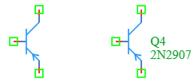

.. _bjt_pnp_element:

PNP Bipolar Junction Transistor
================================

The **PNP Bipolar Junction Transistor** is a fundamental active semiconductor component in the DSpice Semiconductor library. It is a three-terminal device used for amplification, switching, and signal modulation. The PNP transistor is the complementary counterpart to the NPN transistor, distinguished by the direction of the emitter arrow in the schematic symbol. It leverages the ngspice ``Q`` element with a referenced PNP model for accurate DC, AC, and transient analysis.

Symbol
------

The schematic symbol for the PNP BJT follows the IEEE/ANSI standard representation. 

The symbol features **three connection terminals** marked by green squares:
- **Base (B):** Left terminal (control input)
- **Collector (C):** Top terminal (main current output)
- **Emitter (E):** Bottom terminal with inward arrow (main current input)

The symbol displays the component name (e.g., Q4) and the model name (e.g., 2N2907).

Description
-----------

A PNP transistor is a current-controlled device where a small current flowing out of the base terminal controls a larger current flowing from emitter to collector. Key characteristics include:

- **Three-Terminal Device:** Base (B), Collector (C), and Emitter (E).
- **Current Flow Direction:** Conventional current flows from emitter to collector (opposite to NPN).
- **Base Current:** Flows **out** of the base terminal (opposite to NPN where it flows in).
- **Voltage Polarity:** Emitter is at higher potential than collector in normal operation (V_E > V_C).
- **Current Amplification:** The collector current (Ic) is proportional to the base current (Ib), with the ratio defined by the current gain (β or hFE).
- **Operating Regions:** Cutoff, Active (linear amplification), and Saturation (switching).
- **Complementary to NPN:** Used in push-pull configurations, complementary symmetry amplifiers, and H-bridge circuits.

The PNP transistor is essential for complementary amplification, high-side switching, and analog signal processing.

Netlist Format
--------------

In the SPICE netlist generated by DSpice, the PNP BJT is represented using the following syntax:

.. code-block:: text

   Q<name> <collector> <base> <emitter> [<substrate>] <model_name> [area=<value>] [off] [IC=<Veb>, <Vec>]

Where:

- ``Q<name>``: Unique identifier starting with 'Q' (e.g., Q1, Q_AMP, Q_SWITCH).
- ``<collector>``: Collector terminal node number or name.
- ``<base>``: Base terminal node number or name.
- ``<emitter>``: Emitter terminal node number or name.
- ``[<substrate>]``: Optional substrate node (for integrated circuit models, usually omitted for discrete transistors).
- ``<model_name>``: Reference to a PNP BJT model defined with a ``.MODEL`` statement with type ``PNP`` (e.g., 2N2907, 2N3906, Q_PNP).
- ``[area=<value>]``: Optional area factor (default: 1). Multiplies the model parameters to simulate larger or smaller transistors.
- ``[off]``: Optional keyword to set the initial state of the transistor to OFF for DC analysis.
- ``[IC=<Veb>, <Vec>]``: Optional initial conditions specifying the emitter-base and emitter-collector voltages at time t=0 in Volts.

.. note::
   The PNP BJT model must be defined separately using a ``.MODEL`` statement with type ``PNP``. For example:
   
   .. code-block:: text
   
      .MODEL 2N2907 PNP (IS=1.41f BF=255.9 VAF=74.03 IKF=0.2847 XTB=1.5 BR=6.092 VAR=17.91 IKR=0 RB=1 CJC=7.306p MJC=0.3416 VJC=0.75 FC=0.5 CJE=22.01p MJE=0.377 VJE=0.75 TR=46.91n TF=411.1p ITF=1.761 VTF=13.32 XTF=417.1)

Examples
~~~~~~~~

**Example 1: Basic PNP Amplifier**

The image above shows a PNP BJT configured with name ``Q4`` and model ``2N2907``:

.. code-block:: text

   Q4 collector base emitter 2N2907

This represents:
- **Component Name:** Q4
- **Collector:** Connected to node ``collector``
- **Base:** Connected to node ``base``
- **Emitter:** Connected to node ``emitter``
- **Model:** 2N2907 (general-purpose PNP transistor, complementary to 2N2222)
- **Application:** Common-emitter amplifier, high-side switch

**Example 2: Complementary Push-Pull Pair**

.. code-block:: text

   Q_NPN out base gnd 2N2222
   Q_PNP vcc base out 2N2907

This represents a complementary push-pull output stage:
- **NPN (2N2222):** Sinks current from output to ground
- **PNP (2N2907):** Sources current from VCC to output
- **Application:** Class B or Class AB amplifier output stage

**Example 3: High-Side Switch**

.. code-block:: text

   Q_SWITCH vcc control load 2N2907

This represents:
- **Component Name:** Q_SWITCH
- **Emitter:** Connected to VCC (positive supply)
- **Base:** Connected to control signal
- **Collector:** Connected to load
- **Application:** High-side switch for controlling load connected to ground

**Example 4: PNP with Initial Conditions**

.. code-block:: text

   Q1 c b e 2N2907 IC=0.7 5.0

This represents:
- **Initial Veb:** 0.7 V (forward-biased emitter-base junction)
- **Initial Vec:** 5.0 V (emitter-collector voltage)
- **Application:** Transient analysis starting from a known active region state

The collector current in the active region is governed by:

.. math::

   I_C = \beta \times I_B = I_S \times e^{\frac{V_{EB}}{V_T}}

Where:
- :math:`\beta` (or hFE) is the current gain (model parameter ``BF``)
- :math:`I_S` is the saturation current (model parameter ``IS``)
- :math:`V_{EB}` is the emitter-base voltage (positive for PNP in active mode)
- :math:`V_T` is the thermal voltage (~26 mV at room temperature)

**Key Difference from NPN:**
For PNP transistors, the voltage polarities are reversed:
- :math:`V_{EB} > 0` for forward bias (emitter more positive than base)
- :math:`V_{EC} > 0` in active mode (emitter more positive than collector)
- Current flows from emitter to collector (opposite to NPN)

This format ensures full compatibility with ngspice and allows seamless integration into larger circuit netlists.

Advanced Parameters & Symbol Modification
-----------------------------------------

DSpice supports advanced simulation studies through optional parameters that can be added directly to the component symbol. This feature allows users to customize component behavior without altering the global model library.

Adding Initial Conditions (IC)
~~~~~~~~~~~~~~~~~~~~~~~~~~~~~~

To perform transient analysis with specific starting conditions, you can modify the PNP BJT symbol to expose the ``IC`` parameter:

1. **Open Symbol Editor:** Right-click the PNP BJT symbol in your schematic and select "Edit Symbol" or access it via the Semiconductor library manager.
2. **Add Parameters:** In the symbol properties panel, add new parameter fields named ``IC_VEB`` and ``IC_VEC``.
3. **Map to Netlist:** Ensure these parameters are mapped to the SPICE ``IC`` attribute in the netlist generation settings.
4. **Save & Use:** Save the modified symbol. When placed in a schematic, you can now enter specific initial voltages directly in the component's property dialog.

Common PNP Model Parameters
~~~~~~~~~~~~~~~~~~~~~~~~~~~

When defining a custom PNP BJT model using ``.MODEL``, the following parameters are available (same as NPN but with type ``PNP``):

**DC Parameters:**
- ``IS``: Saturation current (default: 1e-16 A)
- ``BF``: Ideal maximum forward beta (default: 100)
- ``NF``: Forward current emission coefficient (default: 1)
- ``VAF``: Forward Early voltage (default: ∞)
- ``IKF``: Corner for forward-beta high-current roll-off (default: ∞)
- ``BR``: Ideal maximum reverse beta (default: 1)
- ``NR``: Reverse current emission coefficient (default: 1)
- ``VAR``: Reverse Early voltage (default: ∞)
- ``IKR``: Corner for reverse-beta high-current roll-off (default: ∞)
- ``RB``: Base resistance (default: 0 Ω)
- ``RC``: Collector resistance (default: 0 Ω)
- ``RE``: Emitter resistance (default: 0 Ω)

**AC/Capacitance Parameters:**
- ``CJE``: Base-emitter zero-bias depletion capacitance (default: 0 F)
- ``VJE``: Base-emitter built-in potential (default: 0.75 V)
- ``MJE``: Base-emitter exponential factor (default: 0.33)
- ``CJC``: Base-collector zero-bias depletion capacitance (default: 0 F)
- ``VJC``: Base-collector built-in potential (default: 0.75 V)
- ``MJC``: Base-collector exponential factor (default: 0.33)

**Transient Parameters:**
- ``TF``: Ideal forward transit time (default: 0 s)
- ``TR``: Ideal reverse transit time (default: 0 s)
- ``XTF``: Coefficient for bias dependence of TF (default: 0)
- ``VTF``: Voltage describing VEB dependence of TF (default: )
- ``ITF``: High-current parameter for TF (default: 0)

Use Cases
~~~~~~~~~

- **Complementary Amplification:** Paired with NPN transistors in push-pull output stages for efficient power amplification (Class B, Class AB).
- **High-Side Switching:** Controlling loads connected to ground by switching the positive supply rail.
- **Current Sourcing:** Providing current to loads from the positive supply (opposite to NPN which sinks current to ground).
- **H-Bridge Circuits:** Used in motor control applications alongside NPN transistors for bidirectional control.
- **Complementary Symmetry Circuits:** Building circuits with matched NPN/PNP pairs for balanced performance.
- **Voltage Regulation:** Using PNP transistors as pass elements in negative voltage regulators or high-side regulators.
- **Signal Inversion:** Common-emitter PNP amplifiers provide signal inversion with gain.
- **Level Shifting:** Shifting signal levels between different voltage domains.

**Comparison with NPN:**

.. list-table::
   :header-rows: 1
   :widths: 25 35 35

   * - Characteristic
     - NPN
     - PNP
   * - Emitter Arrow
     - Outward (away from base)
     - Inward (toward base)
   * - Conventional Current Flow
     - Collector to Emitter
     - Emitter to Collector
   * - Base Current
     - Flows into the base
     - Flows out of the base
   * - Voltage Polarity
     - V_C > V_E (normal operation)
     - V_E > V_C (normal operation)
   * - Common Models
     - 2N2222, 2N3904
     - 2N2907, 2N3906
   * - Typical Use
     - Low-side switch, sinking current
     - High-side switch, sourcing current
     

.. note::
   PNP transistors are the complementary counterparts to NPN transistors. In circuit design, they are often used together to create symmetric circuits with balanced performance.
   
   When using PNP transistors, remember that all voltage polarities and current directions are reversed compared to NPN. This is critical for correct biasing and operation.
   
   The PNP model parameters significantly affect simulation accuracy. Always use manufacturer-provided SPICE models when available for critical designs.
   
   For high-frequency applications, pay attention to the transit times (``TF``, ``TR``) and junction capacitances (``CJE``, ``CJC``), as they determine the frequency response and switching speed.