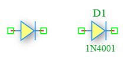

.. _diode_element:

Diode
=====

The **Diode** is a fundamental semiconductor component in the DSpice Semiconductor library. It allows current to flow primarily in one direction (from anode to cathode) while blocking current in the reverse direction. It is based on the standard SPICE diode model and leverages the ngspice ``D`` element with a referenced diode model for accurate DC, AC, and transient analysis.

Symbol
------

The schematic symbol for the Diode follows the IEEE/ANSI standard representation. The symbol displays the component name (e.g., D1) and the model name (e.g., 1N4001).

Description
-----------

A diode is a two-terminal semiconductor device that exhibits nonlinear current-voltage characteristics. It conducts current easily in the forward direction (when the anode voltage is higher than the cathode) and blocks current in the reverse direction (up to the breakdown voltage). Key characteristics include:

- **Unidirectional Conduction:** Allows current flow from anode to cathode when forward-biased.
- **Nonlinear Behavior:** Follows the Shockley diode equation, making it essential for rectification and signal processing.
- **Forward Voltage Drop:** Typically 0.6V to 0.7V for silicon diodes, and 0.2V to 0.3V for Schottky diodes.
- **Reverse Breakdown:** At a specific reverse voltage (breakdown voltage), the diode conducts heavily (used in Zener diodes).
- **Switching Speed:** Characterized by reverse recovery time, important for high-frequency applications.

The diode is essential for rectification, voltage regulation, signal demodulation, protection circuits, and logic gates.

Netlist Format
--------------

In the SPICE netlist generated by DSpice, the Diode is represented using the following syntax:

.. code-block:: text

   D<name> <anode> <cathode> <model_name> [area=<value>] [off] [IC=<Vd>]

Where:

- ``D<name>``: Unique identifier starting with 'D' (e.g., D1, D_RECT, D_ZENER).
- ``<anode>``: Anode terminal node number or name (positive side in forward bias).
- ``<cathode>``: Cathode terminal node number or name (negative side in forward bias, marked by the line in the symbol).
- ``<model_name>``: Reference to a diode model defined with a ``.MODEL`` statement (e.g., 1N4001, 1N4148, D_ZENER).
- ``[area=<value>]``: Optional area factor (default: 1). Multiplies the model parameters to simulate larger or smaller diodes.
- ``[off]``: Optional keyword to set the initial state of the diode to OFF for DC analysis.
- ``[IC=<Vd>]``: Optional initial condition specifying the voltage across the diode at time t=0 in Volts.

.. note::
   The diode model must be defined separately using a ``.MODEL`` statement. For example:
   
   .. code-block:: text
   
      .MODEL 1N4001 D (IS=2.52n RS=0.568 N=1.752 CJO=4p M=0.4 TT=20n BV=50 IBV=10u)

Examples
~~~~~~~~

**Example 1: Basic Rectifier Diode**

The image above shows a Diode configured with name ``D1`` and model ``1N4001``:

.. code-block:: text

   D1 in out 1N4001

This represents:
- **Component Name:** D1
- **Anode:** Connected to node ``in``
- **Cathode:** Connected to node ``out``
- **Model:** 1N4001 (general-purpose rectifier diode)
- **Application:** Half-wave or full-wave rectification in power supplies

**Example 2: Zener Diode for Voltage Regulation**

.. code-block:: text

   D_ZENER vdd reg 1N4733A

This represents:
- **Component Name:** D_ZENER
- **Model:** 1N4733A (5.1V Zener diode)
- **Application:** Voltage regulation and reference circuits

**Example 3: Schottky Diode for High-Speed Switching**

.. code-block:: text

   D_SCHOTTKY in out 1N5819 area=2

This represents:
- **Component Name:** D_SCHOTTKY
- **Model:** 1N5819 (Schottky barrier diode, low forward voltage drop ~0.3V)
- **Area Factor:** 2 (simulates a diode with twice the junction area)
- **Application:** High-frequency rectification and reverse polarity protection

**Example 4: Diode with Initial Condition**

.. code-block:: text

   D1 node1 node2 1N4148 IC=0.7

This represents:
- **Initial Voltage:** 0.7 V across the diode at t=0
- **Application:** Transient analysis starting from a known forward-biased state

The current through the diode is governed by the Shockley diode equation:

.. math::

   I_D = I_S \times \left(e^{\frac{V_D}{n \times V_T}} - 1\right)

Where:
- :math:`I_S` is the saturation current (model parameter ``IS``)
- :math:`V_D` is the voltage across the diode
- :math:`n` is the emission coefficient (model parameter ``N``, typically 1-2)
- :math:`V_T` is the thermal voltage (~26 mV at room temperature)

This format ensures full compatibility with ngspice and allows seamless integration into larger circuit netlists.

Advanced Parameters & Symbol Modification
-----------------------------------------

DSpice supports advanced simulation studies through optional parameters that can be added directly to the component symbol. This feature allows users to customize component behavior without altering the global model library.

Adding Series Resistance (Rser) and Parallel Resistance (Rpar)
~~~~~~~~~~~~~~~~~~~~~~~~~~~~~~~~~~~~~~~~~~~~~~~~~~~~~~~~~~~~~~

To model a non-ideal diode with parasitic resistances, you can modify the Diode symbol to expose the ``Rser`` and ``Rpar`` parameters:

1. **Open Symbol Editor:** Right-click the Diode symbol in your schematic and select "Edit Symbol" or access it via the Semiconductor library manager.
2. **Add Parameters:** In the symbol properties panel, add new parameter fields named ``Rser`` and ``Rpar``.
3. **Map to Netlist:** Ensure these parameters are mapped to the appropriate SPICE attributes in the netlist generation settings.
4. **Save & Use:** Save the modified symbol. When placed in a schematic, you can now enter specific resistance values directly in the component's property dialog.

The effective voltage across the diode becomes:

.. math::

   V_{anode} - V_{cathode} = V_D + I_D \times R_{ser}

Where :math:`V_D` is the intrinsic diode voltage and :math:`I_D` is the diode current.

Common Diode Model Parameters
~~~~~~~~~~~~~~~~~~~~~~~~~~~~~

When defining a custom diode model using ``.MODEL``, the following parameters are available:

- ``IS``: Saturation current (default: 1e-14 A)
- ``N``: Emission coefficient (default: 1)
- ``RS``: Series resistance (default: 0 Ω)
- ``BV``: Reverse breakdown voltage (default: ∞)
- ``IBV``: Current at breakdown voltage (default: 1e-10 A)
- ``CJO``: Zero-bias junction capacitance (default: 0 F)
- ``VJ``: Junction potential (default: 1 V)
- ``M``: Grading coefficient (default: 0.5)
- ``TT``: Transit time (default: 0 s)

Use Cases
~~~~~~~~~

- **Rectification:** Converting AC to DC in power supplies using half-wave, full-wave, or bridge rectifier configurations.
- **Voltage Regulation:** Using Zener diodes to maintain a stable reference voltage in power supplies and regulator circuits.
- **Signal Demodulation:** Extracting information from amplitude-modulated (AM) signals in radio receivers.
- **Reverse Polarity Protection:** Preventing damage to circuits when power is connected with incorrect polarity.
- **Clipping and Clamping:** Limiting signal amplitude or shifting DC levels in waveform shaping circuits.
- **Logic Gates:** Implementing diode logic (AND/OR gates) in simple digital circuits.
- **Flyback Protection:** Protecting switching transistors from inductive kickback when driving relays or motors.
- **LED Driving:** Modeling light-emitting diodes for indicator and display applications.

.. note::
   The diode model parameters significantly affect simulation accuracy. Always use manufacturer-provided SPICE models when available for critical designs.
   
   For high-frequency applications, pay attention to the junction capacitance (``CJO``) and transit time (``TT``) parameters, as they determine the switching speed.