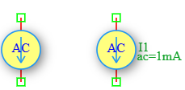

.. _iac_source:

AC Current Source
=================

The **AC Current Source** is an independent small-signal current source in the DSpice Sources library. It is specifically designed for AC small-signal analysis (`.AC` analysis) to determine the frequency response of circuits. Unlike the Sin current source which is used for transient analysis, the AC current source defines the magnitude and phase of a small-signal current stimulus for frequency sweep simulations. It leverages the ngspice ``AC`` keyword within the ``I`` source model.

Symbol
------

The schematic symbol for the AC Current Source follows the IEEE/ANSI standard representation.

Description
-----------

An AC current source provides a small-signal AC current stimulus for frequency domain analysis. It is used exclusively in `.AC` analysis to sweep the frequency and observe the circuit's response (transimpedance gain, phase, admittance, etc.). Key characteristics include:

- **Small-Signal Analysis:** Used for linear AC analysis around the DC operating point.
- **Frequency Sweep:** The source magnitude and phase remain constant while the simulation frequency varies.
- **Magnitude and Phase:** Defines the amplitude and phase angle of the AC current stimulus.
- **DC Operating Point:** The AC source also has a DC value (used in `.OP` and `.TRAN` analysis), which can be set separately.

The AC current source is essential for transimpedance amplifier characterization, current injection testing, admittance analysis, and noise figure measurements.

Netlist Format
--------------

In the SPICE netlist generated by DSpice, the AC current source is represented using the following syntax:

.. code-block:: text

   I<name> <node+> <node-> AC <magnitude> <phase>

Where:

- ``I<name>``: Unique identifier starting with 'I' (e.g., I1, I_AC, I_SIG).
- ``<node+>``: Positive terminal node number or name (current exits this node).
- ``<node->``: Negative terminal node number or name (current enters this node).
- ``AC``: Keyword specifying AC small-signal analysis mode.
- ``<magnitude>``: AC magnitude in Amperes (peak value for small-signal analysis).
- ``<phase>``: AC phase shift in degrees (optional, default: 0°).

.. note::
   The AC source can also include a DC value for operating point analysis:
   
   .. code-block:: text
   
      I<name> <node+> <node-> DC <dc_value> AC <magnitude> <phase>

Examples
~~~~~~~~

**Example 1: Basic AC Current Source**

The image above shows an AC current source configured with ``ac=1mA``:

.. code-block:: text

   I1 1 0 AC 1m

This defines:
- **AC Magnitude:** 1 mA (small-signal amplitude)
- **AC Phase:** 0° (default)
- **Application:** Standard 1 mA AC current stimulus for transimpedance and admittance analysis

Using a 1 mA AC source simplifies transimpedance calculations, as the output voltage directly represents the transimpedance gain (Z = Vout/Iin = Vout/1m).

**Example 2: AC Current Source with Phase Shift**

.. code-block:: text

   I_SIG in gnd AC 100u 90

This defines:
- **AC Magnitude:** 100 µA (small-signal)
- **AC Phase:** 90° (phase-shifted stimulus)
- **Application:** Quadrature current injection for phase-sensitive measurements

**Example 3: AC Current Source with DC Bias**

.. code-block:: text

   I_BIAS vdd gnd DC 1m AC 100u 0

This defines:
- **DC Value:** 1 mA (used for DC operating point calculation)
- **AC Magnitude:** 100 µA (small-signal amplitude for AC analysis)
- **AC Phase:** 0°
- **Application:** Biasing a transistor while injecting a small AC test current for small-signal parameter extraction

**Example 4: Differential AC Current Sources**

.. code-block:: text

   I_INP inp gnd AC 0.5m 0
   I_INN inn gnd AC 0.5m 180

This defines a differential AC current stimulus:
- **Positive input:** 0.5 mA at 0°
- **Negative input:** 0.5 mA at 180°
- **Differential amplitude:** 1 mA
- **Application:** Differential amplifier testing with balanced AC current inputs

The AC source magnitude and phase are used in the frequency domain transfer function:

.. math::

   Z(j\omega) = \frac{V_{out}(j\omega)}{I_{in}(j\omega)}

Where :math:`I_{in}` is the AC source magnitude and :math:`V_{out}` is the simulated output voltage at each frequency point. This represents the **transimpedance** of the circuit.

This format ensures full compatibility with ngspice and allows seamless integration into larger circuit netlists.

Advanced Parameters & Symbol Modification
-----------------------------------------

DSpice supports advanced simulation studies through optional parameters that can be added directly to the component symbol. This feature allows users to customize source behavior without altering the global model library.

Adding Parallel Resistance (Rpar)
~~~~~~~~~~~~~~~~~~~~~~~~~~~~~~~~~

To model a non-ideal current source with finite output impedance, you can modify the Iac symbol to expose the ``Rpar`` parameter:

1. **Open Symbol Editor:** Right-click the AC Current Source symbol in your schematic and select "Edit Symbol" or access it via the Sources library manager.
2. **Add Parameter:** In the symbol properties panel, add a new parameter field named ``Rpar``.
3. **Map to Netlist:** Ensure this parameter is mapped to the SPICE ``Rpar`` attribute in the netlist generation settings.
4. **Save & Use:** Save the modified symbol. When placed in a schematic, you can now enter a specific parallel resistance value directly in the component's property dialog.

The effective output current becomes:

.. math::

   I_{load} = I_{ac} \times \frac{R_{par}}{R_{par} + R_{load}}

Where :math:`R_{load}` is the impedance of the connected circuit. As :math:`R_{par} \to \infty`, the source approaches ideal behavior.

Use Cases
~~~~~~~~~

- **Transimpedance Amplifier (TIA) Characterization:** Measuring the voltage output per unit of input current across frequency.
- **Admittance Analysis:** Calculating input and output admittance of circuits over a frequency range.
- **Current Injection Testing:** Injecting small AC currents to measure circuit response without disturbing the DC bias.
- **Noise Figure Measurement:** Serving as the reference source for noise figure calculations in RF amplifiers.
- **Photodiode Modeling:** Simulating the AC component of photodiode current in optical receiver circuits.
- **Impedance Spectroscopy:** Sweeping frequency to characterize electrochemical cells and material properties.
- **Stability Analysis:** Evaluating phase margin and gain margin of current-mode feedback systems.

.. note::
   The AC current source is **only active during `.AC` analysis**. In `.TRAN` (transient) analysis, the AC magnitude is ignored and only the DC value is used.
   
   For transient sinusoidal current analysis, use the **Sin Current Source** instead, which defines frequency, amplitude, and phase for time-domain simulation.
