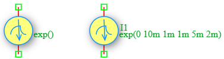

.. _iexp_source:

Exponential Current Source
==========================

The **Exponential Current Source** is an independent time-varying current source in the DSpice Sources library. It generates a waveform with exponential rise and fall characteristics, commonly used to model real-world transient events such as switching spikes, ESD pulses, and inductive transients. It leverages the ngspice ``EXP`` function within the ``I`` source model.

Symbol
------

The schematic symbol for the Exponential Current Source follows the IEEE/ANSI standard representation. It consists of a yellow circle containing a blue exponential curve symbol with a downward-pointing arrow indicating the direction of conventional current flow. 

Description
-----------

An Exponential current source produces a time-varying waveform defined by two exponential segments: a rising phase and a falling phase. Each phase is characterized by a delay time and a time constant. Key characteristics include:

- **Exponential Rise:** The current rises from I1 toward I2 with a time constant TAU1 after delay TD1.
- **Exponential Fall:** The current falls back toward I1 with a time constant TAU2 after delay TD2.
- **Realistic Transients:** Models real-world phenomena such as inductive kickback currents, ESD pulses, and capacitor charging/discharging currents.
- **Asymmetric Behavior:** Rise and fall time constants can be independently controlled.

The Exponential current source is widely used in ESD testing, switching transient analysis, pulse shaping, and electromagnetic compatibility (EMC) studies.

Netlist Format
--------------

In the SPICE netlist generated by DSpice, the Exponential current source is represented using the following syntax:

.. code-block:: text

   I<name> <node+> <node-> EXP(I1 I2 TD1 TAU1 TD2 TAU2)

Where:

- ``I<name>``: Unique identifier starting with 'I' (e.g., I1, I_ESD, I_TRANS).
- ``<node+>``: Positive terminal node number or name (current exits this node).
- ``<node->``: Negative terminal node number or name (current enters this node).
- ``EXP(...)``: Keyword specifying exponential waveform with the following parameters:
  - ``I1``: Initial current value in Amperes (before the rise phase).
  - ``I2``: Pulsed current value in Amperes (the target peak value during the rise phase).
  - ``TD1``: Rise delay time in seconds (time before the exponential rise begins).
  - ``TAU1``: Rise time constant in seconds (controls the speed of the rising edge).
  - ``TD2``: Fall delay time in seconds (time before the exponential fall begins).
  - ``TAU2``: Fall time constant in seconds (controls the speed of the falling edge).

Examples
~~~~~~~~

**Example 1: Basic Exponential Current Pulse**

The image above shows an Exponential current source configured as ``EXP(0 10m 1m 1m 5m 2m)``:

.. code-block:: text

   I1 1 0 EXP(0 10m 1m 1m 5m 2m)

This generates:
- **Initial Current (I1):** 0 A
- **Peak Current (I2):** 10 mA
- **Rise Delay (TD1):** 1 ms (rise starts after 1 ms)
- **Rise Time Constant (TAU1):** 1 ms (exponential rise toward 10 mA)
- **Fall Delay (TD2):** 5 ms (fall starts after 5 ms)
- **Fall Time Constant (TAU2):** 2 ms (exponential fall toward 0 A)

The resulting waveform rises exponentially from 0 A toward 10 mA starting at t=1 ms, then falls exponentially back toward 0 A starting at t=5 ms.

**Example 2: ESD Current Pulse Simulation**

.. code-block:: text

   I_ESD test gnd EXP(0 1 10n 5n 50n 30n)

This generates:
- **Initial Current:** 0 A
- **Peak Current:** 1 A (ESD spike)
- **Rise Delay:** 10 ns
- **Rise Time Constant:** 5 ns (very fast rise)
- **Fall Delay:** 50 ns
- **Fall Time Constant:** 30 ns (slower decay)
- **Application:** Modeling an electrostatic discharge (ESD) current event for circuit protection testing

**Example 3: Inductive Switching Transient**

.. code-block:: text

   I_KICK node1 node2 EXP(0.1 2 0 100n 1u 500n)

This generates:
- **Initial Current:** 100 mA (steady-state)
- **Peak Current:** 2 A (inductive spike)
- **Rise Delay:** 0 s (immediate rise)
- **Rise Time Constant:** 100 ns (fast spike)
- **Fall Delay:** 1 µs
- **Fall Time Constant:** 500 ns (slower decay)
- **Application:** Modeling current spike when switching an inductive load

The current waveform is calculated as:

.. math::

   I(t) = \begin{cases}
   I_1 & \text{for } 0 \leq t \leq TD1 \\
   I_1 + (I_2 - I_1) \times \left(1 - e^{-\frac{t - TD1}{TAU1}}\right) & \text{for } TD1 < t \leq TD2 \\
   I_1 + (I_2 - I_1) \times \left(1 - e^{-\frac{TD2 - TD1}{TAU1}}\right) \times e^{-\frac{t - TD2}{TAU2}} & \text{for } t > TD2
   \end{cases}

This format ensures full compatibility with ngspice and allows seamless integration into larger circuit netlists.

Advanced Parameters & Symbol Modification
-----------------------------------------

DSpice supports advanced simulation studies through optional parameters that can be added directly to the component symbol. This feature allows users to customize source behavior without altering the global model library.

Adding Parallel Resistance (Rpar)
~~~~~~~~~~~~~~~~~~~~~~~~~~~~~~~~~

To model a non-ideal current source with finite output impedance, you can modify the Iexp symbol to expose the ``Rpar`` parameter:

1. **Open Symbol Editor:** Right-click the Exponential Current Source symbol in your schematic and select "Edit Symbol" or access it via the Sources library manager.
2. **Add Parameter:** In the symbol properties panel, add a new parameter field named ``Rpar``.
3. **Map to Netlist:** Ensure this parameter is mapped to the SPICE ``Rpar`` attribute in the netlist generation settings.
4. **Save & Use:** Save the modified symbol. When placed in a schematic, you can now enter a specific parallel resistance value directly in the component's property dialog.

The effective output current becomes:

.. math::

   I_{load} = I_{exp}(t) \times \frac{R_{par}}{R_{par} + R_{load}}

Where :math:`R_{load}` is the impedance of the connected circuit. As :math:`R_{par} \to \infty`, the source approaches ideal behavior.

Use Cases
~~~~~~~~~

- **ESD Testing:** Simulating electrostatic discharge current events to evaluate circuit protection components (TVS diodes, varistors).
- **Switching Transients:** Modeling current spikes caused by inductive loads when switching relays or motors.
- **Pulse Shaping:** Generating realistic current pulse waveforms with controlled rise and fall characteristics.
- **EMC Analysis:** Studying electromagnetic compatibility issues caused by fast transient current events.
- **Inductor Charging:** Modeling the charging and discharging behavior of RL circuits with exponential characteristics.
- **Fault Simulation:** Simulating current faults and transients for robustness testing of electronic systems.
- **Battery Modeling:** Simulating pulsed load currents with realistic rise and fall characteristics.

.. note::
   The time constants (TAU1, TAU2) determine how quickly the waveform approaches its target values. After one time constant, the waveform reaches approximately 63.2% of the target. After five time constants, it reaches approximately 99.3% (considered fully settled).