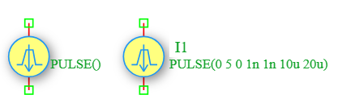

.. _ipulse_source:

Pulse Current Source
====================

The **Pulse Current Source** is an independent time-varying current source in the DSpice Sources library. It generates a pulsed current waveform with configurable rise time, fall time, pulse width, and period. It is essential for digital circuit simulation, switching analysis, and transient testing of analog circuits. It leverages the ngspice ``PULSE`` function within the ``I`` source model.

Symbol
------

The schematic symbol for the Pulse Current Source follows the IEEE/ANSI standard representation. It consists of a yellow circle containing a blue pulse waveform symbol with a downward-pointing arrow indicating the direction of conventional current flow. It features two connection terminals marked by green squares, with red terminal leads extending from the top and bottom of the circle.

Description
-----------

A Pulse current source produces a time-varying rectangular or trapezoidal current waveform defined by initial value, pulsed value, delay, rise time, fall time, pulse width, and period. Key characteristics include:

- **Pulsed Output:** Generates a periodic current waveform that switches between two levels.
- **Configurable Parameters:** Supports initial value, pulsed value, delay time, rise time, fall time, pulse width, and period.
- **Digital Simulation Role:** Commonly used to model clock signals, data streams, and switching currents in digital and mixed-signal circuits.
- **Transient Analysis:** Essential for observing circuit behavior during switching events, including rise/fall times and propagation delays.

The Pulse current source is widely used in digital logic testing, power electronics switching, PWM signal generation, and clock distribution analysis.

Netlist Format
--------------

In the SPICE netlist generated by DSpice, the Pulse current source is represented using the following syntax:

.. code-block:: text

   I<name> <node+> <node-> PULSE(I1 I2 Td Tr Tf Pw Per)

Where:

- ``I<name>``: Unique identifier starting with 'I' (e.g., I1, I_CLK, I_PWM).
- ``<node+>``: Positive terminal node number or name (current exits this node).
- ``<node->``: Negative terminal node number or name (current enters this node).
- ``PULSE(...)``: Keyword specifying pulsed waveform with the following parameters:
  - ``I1``: Initial current value in Amperes (before the pulse starts).
  - ``I2``: Pulsed current value in Amperes (the peak value during the pulse).
  - ``Td``: Delay time in seconds before the first pulse starts (default: 0).
  - ``Tr``: Rise time in seconds (time to transition from I1 to I2, default: simulation timestep).
  - ``Tf``: Fall time in seconds (time to transition from I2 to I1, default: simulation timestep).
  - ``Pw``: Pulse width in seconds (duration at I2 level).
  - ``Per``: Period in seconds (total time for one complete cycle).

Examples
~~~~~~~~

**Example 1: Basic Pulse Current Source**

The image above shows a Pulse current source configured as ``PULSE(0 5 0 1n 1n 10u 20u)``:

.. code-block:: text

   I1 1 0 PULSE(0 5 0 1n 1n 10u 20u)

This generates:
- **Initial Value:** 0 A (no current before pulse)
- **Pulsed Value:** 5 A (peak current during pulse)
- **Delay:** 0 s (pulse starts immediately)
- **Rise Time:** 1 ns (fast transition from 0 to 5 A)
- **Fall Time:** 1 ns (fast transition from 5 A to 0)
- **Pulse Width:** 10 µs (duration of high state)
- **Period:** 20 µs (total cycle time, giving 50% duty cycle)
- **Frequency:** f = 1/Per = 1/20µ = 50 kHz

The resulting waveform is a square wave with 5 A peak amplitude and 50 kHz frequency.

**Example 2: Clock Signal with Non-Zero Baseline**

.. code-block:: text

   I_CLK vdd gnd PULSE(1m 10m 1u 5n 5n 50n 100n)

This generates:
- **Initial Value:** 1 mA (baseline current)
- **Pulsed Value:** 10 mA (peak current)
- **Delay:** 1 µs (pulse starts after 1 µs)
- **Rise Time:** 5 ns
- **Fall Time:** 5 ns
- **Pulse Width:** 50 ns
- **Period:** 100 ns (10 MHz clock frequency)
- **Duty Cycle:** 50%

**Example 3: PWM Signal with Variable Duty Cycle**

.. code-block:: text

   I_PWM load gnd PULSE(0 100m 0 10n 10n 25u 100u)

This generates:
- **Initial Value:** 0 A
- **Pulsed Value:** 100 mA
- **Delay:** 0 s
- **Rise Time:** 10 ns
- **Fall Time:** 10 ns
- **Pulse Width:** 25 µs
- **Period:** 100 µs (10 kHz frequency)
- **Duty Cycle:** 25% (pulse is high for 25% of the period)

The current waveform is calculated as:

.. math::

   I(t) = \begin{cases} 
   I_1 & \text{for } t < T_d \\
   I_1 + (I_2 - I_1) \times \frac{t - T_d}{T_r} & \text{for } T_d \leq t < T_d + T_r \\
   I_2 & \text{for } T_d + T_r \leq t < T_d + T_r + P_w \\
   I_2 - (I_2 - I_1) \times \frac{t - T_d - T_r - P_w}{T_f} & \text{for } T_d + T_r + P_w \leq t < T_d + T_r + P_w + T_f \\
   I_1 & \text{for } T_d + T_r + P_w + T_f \leq t < T_d + Per \\
   \end{cases}

repeating with period ``Per``.

This format ensures full compatibility with ngspice and allows seamless integration into larger circuit netlists.

Advanced Parameters & Symbol Modification
-----------------------------------------

DSpice supports advanced simulation studies through optional parameters that can be added directly to the component symbol. This feature allows users to customize source behavior without altering the global model library.

Adding Parallel Resistance (Rpar)
~~~~~~~~~~~~~~~~~~~~~~~~~~~~~~~~~

To model a non-ideal current source with finite output impedance, you can modify the Ipulse symbol to expose the ``Rpar`` parameter:

1. **Open Symbol Editor:** Right-click the Pulse Current Source symbol in your schematic and select "Edit Symbol" or access it via the Sources library manager.
2. **Add Parameter:** In the symbol properties panel, add a new parameter field named ``Rpar``.
3. **Map to Netlist:** Ensure this parameter is mapped to the SPICE ``Rpar`` attribute in the netlist generation settings.
4. **Save & Use:** Save the modified symbol. When placed in a schematic, you can now enter a specific parallel resistance value directly in the component's property dialog.

The effective output current becomes:

.. math::

   I_{load} = I_{pulse}(t) \times \frac{R_{par}}{R_{par} + R_{load}}

Where :math:`R_{load}` is the impedance of the connected circuit. As :math:`R_{par} \to \infty`, the source approaches ideal behavior.

Use Cases
~~~~~~~~~

- **Digital Logic Testing:** Simulating clock signals and data streams for testing digital circuits and flip-flops.
- **PWM Control:** Generating pulse-width modulated currents for motor control and power regulation.
- **Switching Power Supplies:** Modeling switching currents in buck, boost, and flyback converters.
- **Transient Response:** Observing how circuits respond to sudden current changes, including ringing and overshoot.
- **EMI Analysis:** Studying electromagnetic interference caused by fast current transitions in high-speed circuits.
- **Sensor Simulation:** Modeling pulsed current-output sensors such as photodiodes in time-of-flight applications.

