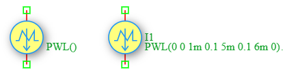

.. _ipwl_source:

Piecewise Linear Current Source
================================

The **Piecewise Linear (PWL) Current Source** is an independent time-varying current source in the DSpice Sources library. It generates a waveform defined by a series of time-current coordinate pairs, allowing users to create arbitrary current waveforms by linearly interpolating between specified points. It leverages the ngspice ``PWL`` function within the ``I`` source model.

Symbol
------

The schematic symbol for the PWL Current Source follows the IEEE/ANSI standard representation.

Description
-----------

A PWL current source produces a time-varying waveform defined by a sequence of (time, current) coordinate pairs. The source linearly interpolates between consecutive points, creating a piecewise linear approximation of any desired waveform. Key characteristics include:

- **Arbitrary Waveforms:** Can model any current waveform by specifying sufficient coordinate points.
- **Linear Interpolation:** Current values between specified points are calculated by linear interpolation.
- **Flexible Definition:** Supports as many time-current pairs as needed for accurate waveform representation.
- **Realistic Modeling:** Ideal for modeling measured or experimentally obtained current waveforms.

The PWL current source is widely used in modeling real-world current profiles, battery discharge curves, motor drive currents, and custom test stimuli.

Netlist Format
--------------

In the SPICE netlist generated by DSpice, the PWL current source is represented using the following syntax:

.. code-block:: text

   I<name> <node+> <node-> PWL(t1 I1 t2 I2 t3 I3 ...)

Where:

- ``I<name>``: Unique identifier starting with 'I' (e.g., I1, I_PWL, I_CUSTOM).
- ``<node+>``: Positive terminal node number or name (current exits this node).
- ``<node->``: Negative terminal node number or name (current enters this node).
- ``PWL(...)``: Keyword specifying piecewise linear waveform with pairs of time and current values:
  - ``t1, t2, t3, ...``: Time points in seconds (must be in ascending order).
  - ``I1, I2, I3, ...``: Current values in Amperes at the corresponding time points.

The source requires an even number of parameters (time-current pairs). At least two pairs (four parameters) are needed to define a waveform.

Examples
~~~~~~~~

**Example 1: Trapezoidal Current Pulse**

The image above shows a PWL current source configured as ``PWL(0 0 1m 0.1 5m 0.1 6m 0)``:

.. code-block:: text

   I1 1 0 PWL(0 0 1m 0.1 5m 0.1 6m 0)

This generates a trapezoidal waveform:
- **t = 0 ms:** I = 0 A (starting point)
- **t = 1 ms:** I = 0.1 A (linear rise from 0 to 0.1A in 1ms)
- **t = 5 ms:** I = 0.1 A (constant current for 4ms)
- **t = 6 ms:** I = 0 A (linear fall from 0.1A to 0 in 1ms)

The resulting waveform is a trapezoidal pulse with:
- **Rise time:** 1 ms
- **Flat top duration:** 4 ms (from 1ms to 5ms)
- **Fall time:** 1 ms
- **Total duration:** 6 ms
- **Peak current:** 100 mA

**Example 2: Battery Discharge Profile**

.. code-block:: text

   I_BATT load gnd PWL(0 2 1000 2 1001 1.5 2000 1.5 2001 1 3000 1 3001 0.5 4000 0.5)

This generates a stepped discharge profile:
- **0-1000s:** 2 A discharge
- **1000-1001s:** Transition to 1.5 A
- **1001-2000s:** 1.5 A discharge
- **2000-2001s:** Transition to 1 A
- **2001-3000s:** 1 A discharge
- **3000-3001s:** Transition to 0.5 A
- **3001-4000s:** 0.5 A discharge
- **Application:** Modeling a battery discharge test with varying load currents

**Example 3: Motor Start-up Current**

.. code-block:: text

   I_MOTOR vdd gnd PWL(0 0 0.1 5 0.5 2 1 1.5 2 1.2 5 1.2)

This generates a motor start-up profile:
- **t = 0s:** I = 0 A (motor off)
- **t = 0.1s:** I = 5 A (inrush current spike)
- **t = 0.5s:** I = 2 A (deceleration to running current)
- **t = 1s:** I = 1.5 A (approaching steady state)
- **t = 2s:** I = 1.2 A (near steady state)
- **t = 5s:** I = 1.2 A (steady-state running current)
- **Application:** Modeling the start-up transient of an electric motor

The current waveform is calculated by linear interpolation between consecutive points:

.. math::

   I(t) = I_k + \frac{I_{k+1} - I_k}{t_{k+1} - t_k} \times (t - t_k)

for :math:`t_k \leq t \leq t_{k+1}`, where :math:`k` is the index of the current segment.

For :math:`t > t_{last}`, the current remains constant at :math:`I_{last}`.

This format ensures full compatibility with ngspice and allows seamless integration into larger circuit netlists.

Advanced Parameters & Symbol Modification
-----------------------------------------

DSpice supports advanced simulation studies through optional parameters that can be added directly to the component symbol. This feature allows users to customize source behavior without altering the global model library.

Adding Parallel Resistance (Rpar)
~~~~~~~~~~~~~~~~~~~~~~~~~~~~~~~~~

To model a non-ideal current source with finite output impedance, you can modify the Ipwl symbol to expose the ``Rpar`` parameter:

1. **Open Symbol Editor:** Right-click the PWL Current Source symbol in your schematic and select "Edit Symbol" or access it via the Sources library manager.
2. **Add Parameter:** In the symbol properties panel, add a new parameter field named ``Rpar``.
3. **Map to Netlist:** Ensure this parameter is mapped to the SPICE ``Rpar`` attribute in the netlist generation settings.
4. **Save & Use:** Save the modified symbol. When placed in a schematic, you can now enter a specific parallel resistance value directly in the component's property dialog.

The effective output current becomes:

.. math::

   I_{load} = I_{pwl}(t) \times \frac{R_{par}}{R_{par} + R_{load}}

Where :math:`R_{load}` is the impedance of the connected circuit. As :math:`R_{par} \to \infty`, the source approaches ideal behavior.

Use Cases
~~~~~~~~~

- **Battery Modeling:** Simulating realistic battery discharge and charge profiles with varying current levels.
- **Motor Drive Simulation:** Modeling motor start-up, running, and braking current profiles.
- **Custom Test Stimuli:** Creating arbitrary current waveforms for circuit testing and characterization.
- **Measured Data Import:** Reproducing experimentally measured current waveforms by importing time-current data points.
- **Power Electronics:** Modeling complex switching currents in converters and inverters.
- **Biomedical Applications:** Simulating neural stimulation pulses and cardiac pacemaker currents.
- **Load Profiling:** Modeling time-varying load currents in power distribution systems.

.. note::
   Time points must be specified in strictly ascending order. Duplicate or decreasing time values will cause simulation errors.
   
   For waveforms requiring high accuracy, use more coordinate points in regions where the current changes rapidly.
   