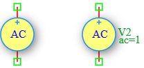

.. _vac_source:

AC Voltage Source
=================

The **AC Voltage Source** is an independent small-signal voltage source in the DSpice Sources library. It is specifically designed for AC small-signal analysis (`.AC` analysis) to determine the frequency response of circuits. Unlike the Sin source which is used for transient analysis, the AC source defines the magnitude and phase of a small-signal stimulus for frequency sweep simulations. It leverages the ngspice ``AC`` keyword within the ``V`` source model.

Symbol
------

The schematic symbol for the AC Voltage Source follows the IEEE/ANSI standard representation.

Description
-----------

An AC voltage source provides a small-signal AC stimulus for frequency domain analysis. It is used exclusively in `.AC` analysis to sweep the frequency and observe the circuit's response (gain, phase, impedance, etc.). Key characteristics include:

- **Small-Signal Analysis:** Used for linear AC analysis around the DC operating point.
- **Frequency Sweep:** The source magnitude and phase remain constant while the simulation frequency varies.
- **Magnitude and Phase:** Defines the amplitude and phase angle of the AC stimulus.
- **DC Operating Point:** The AC source also has a DC value (used in `.OP` and `.TRAN` analysis), which can be set separately.

The AC voltage source is essential for Bode plot generation, filter characterization, amplifier gain measurement, and impedance analysis.

Netlist Format
--------------

In the SPICE netlist generated by DSpice, the AC voltage source is represented using the following syntax:

.. code-block:: text

   V<name> <node+> <node-> AC <magnitude> <phase>

Where:

- ``V<name>``: Unique identifier starting with 'V' (e.g., V1, V_AC, V_SIG).
- ``<node+>``: Positive terminal node number or name.
- ``<node->``: Negative terminal node number or name.
- ``AC``: Keyword specifying AC small-signal analysis mode.
- ``<magnitude>``: AC magnitude in Volts (peak value for small-signal analysis).
- ``<phase>``: AC phase shift in degrees (optional, default: 0°).

.. note::
   The AC source can also include a DC value for operating point analysis:
   
   .. code-block:: text
   
      V<name> <node+> <node-> DC <dc_value> AC <magnitude> <phase>

Examples
~~~~~~~~

**Example 1: Basic AC Source**

The image above shows an AC voltage source configured with ``ac=1``:

.. code-block:: text

   V2 1 0 AC 1

This defines:
- **AC Magnitude:** 1 V (small-signal amplitude)
- **AC Phase:** 0° (default)
- **Application:** Standard 1V AC stimulus for frequency response analysis (Bode plot)

Using a 1V AC source simplifies gain calculations, as the output voltage directly represents the voltage gain (Vout/Vin = Vout/1 = Vout).

**Example 2: AC Source with Phase Shift**

.. code-block:: text

   V_SIG in gnd AC 0.1 90

This defines:
- **AC Magnitude:** 0.1 V (100 mV small-signal)
- **AC Phase:** 90° (phase-shifted stimulus)
- **Application:** Quadrature signal injection for phase-sensitive measurements

**Example 3: AC Source with DC Bias**

.. code-block:: text

   V_BIAS vdd gnd DC 5 AC 1 0

This defines:
- **DC Value:** 5 V (used for DC operating point calculation)
- **AC Magnitude:** 1 V (small-signal amplitude for AC analysis)
- **AC Phase:** 0°
- **Application:** Biasing a transistor amplifier at 5V while injecting a 1V AC test signal

**Example 4: Differential AC Sources**

.. code-block:: text

   V_INP inp gnd AC 0.5 0
   V_INN inn gnd AC 0.5 180

This defines a differential AC stimulus:
- **Positive input:** 0.5 V at 0°
- **Negative input:** 0.5 V at 180°
- **Differential amplitude:** 1 V
- **Application:** Differential amplifier testing with balanced AC inputs

The AC source magnitude and phase are used in the frequency domain transfer function:

.. math::

   H(j\omega) = \frac{V_{out}(j\omega)}{V_{in}(j\omega)}

Where :math:`V_{in}` is the AC source magnitude and :math:`V_{out}` is the simulated output voltage at each frequency point.

This format ensures full compatibility with ngspice and allows seamless integration into larger circuit netlists.

Advanced Parameters & Symbol Modification
-----------------------------------------

DSpice supports advanced simulation studies through optional parameters that can be added directly to the component symbol. This feature allows users to customize source behavior without altering the global model library.

Adding Series Resistance (Rser)
~~~~~~~~~~~~~~~~~~~~~~~~~~~~~~~

To model a non-ideal voltage source with internal resistance, you can modify the Vac symbol to expose the ``Rser`` parameter:

1. **Open Symbol Editor:** Right-click the AC Voltage Source symbol in your schematic and select "Edit Symbol" or access it via the Sources library manager.
2. **Add Parameter:** In the symbol properties panel, add a new parameter field named ``Rser``.
3. **Map to Netlist:** Ensure this parameter is mapped to the SPICE ``Rser`` attribute in the netlist generation settings.
4. **Save & Use:** Save the modified symbol. When placed in a schematic, you can now enter a specific internal resistance value directly in the component's property dialog.

The effective output voltage becomes:

.. math::

   V_{out} = V_{ac} - I_{load} \times R_{series}

Where :math:`I_{load}` is the current drawn by the circuit.

Use Cases
~~~~~~~~~

- **Bode Plot Generation:** Sweeping frequency to plot gain and phase response of filters and amplifiers.
- **Filter Characterization:** Determining cutoff frequencies, bandwidth, and quality factor of passive and active filters.
- **Amplifier Gain Measurement:** Measuring voltage gain, current gain, and power gain across frequency.
- **Impedance Analysis:** Calculating input and output impedance of circuits over a frequency range.
- **Stability Analysis:** Evaluating phase margin and gain margin of feedback systems.
- **Resonance Detection:** Identifying resonant frequencies in LC circuits and mechanical-electrical analogs.
- **Noise Analysis:** Serving as the reference source for noise figure calculations.

.. note::
   The AC source is **only active during `.AC` analysis**. In `.TRAN` (transient) analysis, the AC magnitude is ignored and only the DC value is used.
   
   For transient sinusoidal analysis, use the **Sin Voltage Source** instead, which defines frequency, amplitude, and phase for time-domain simulation.
   
