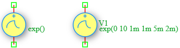

.. _vexp_source:

Exponential Voltage Source
==========================

The **Exponential Voltage Source** is an independent time-varying voltage source in the DSpice Sources library. It generates a waveform with exponential rise and fall characteristics, commonly used to model real-world transient events such as switching spikes, ESD pulses, and damped oscillations. It leverages the ngspice ``EXP`` function within the ``V`` source model.

Symbol
------

The schematic symbol for the Exponential Voltage Source follows the IEEE/ANSI standard representation. 

Description
-----------

An Exponential voltage source produces a time-varying waveform defined by two exponential segments: a rising phase and a falling phase. Each phase is characterized by a delay time and a time constant. Key characteristics include:

- **Exponential Rise:** The voltage rises from V1 toward V2 with a time constant TAU1 after delay TD1.
- **Exponential Fall:** The voltage falls back toward V1 with a time constant TAU2 after delay TD2.
- **Realistic Transients:** Models real-world phenomena such as inductive kickback, ESD pulses, and capacitor charging/discharging.
- **Asymmetric Behavior:** Rise and fall time constants can be independently controlled.

The Exponential voltage source is widely used in ESD testing, switching transient analysis, pulse shaping, and electromagnetic compatibility (EMC) studies.

Netlist Format
--------------

In the SPICE netlist generated by DSpice, the Exponential voltage source is represented using the following syntax:

.. code-block:: text

   V<name> <node+> <node-> EXP(V1 V2 TD1 TAU1 TD2 TAU2)

Where:

- ``V<name>``: Unique identifier starting with 'V' (e.g., V1, V_ESD, V_TRANS).
- ``<node+>``: Positive terminal node number or name.
- ``<node->``: Negative terminal node number or name.
- ``EXP(...)``: Keyword specifying exponential waveform with the following parameters:
  - ``V1``: Initial voltage value in Volts (before the rise phase).
  - ``V2``: Pulsed voltage value in Volts (the target peak value during the rise phase).
  - ``TD1``: Rise delay time in seconds (time before the exponential rise begins).
  - ``TAU1``: Rise time constant in seconds (controls the speed of the rising edge).
  - ``TD2``: Fall delay time in seconds (time before the exponential fall begins).
  - ``TAU2``: Fall time constant in seconds (controls the speed of the falling edge).

Examples
~~~~~~~~

**Example 1: Basic Exponential Pulse**

The image above shows an Exponential voltage source configured as ``EXP(0 10 1m 1m 5m 2m)``:

.. code-block:: text

   V1 1 0 EXP(0 10 1m 1m 5m 2m)

This generates:
- **Initial Voltage (V1):** 0 V
- **Peak Voltage (V2):** 10 V
- **Rise Delay (TD1):** 1 ms (rise starts after 1 ms)
- **Rise Time Constant (TAU1):** 1 ms (exponential rise toward 10V)
- **Fall Delay (TD2):** 5 ms (fall starts after 5 ms)
- **Fall Time Constant (TAU2):** 2 ms (exponential fall toward 0V)

The resulting waveform rises exponentially from 0V toward 10V starting at t=1ms, then falls exponentially back toward 0V starting at t=5ms.

**Example 2: ESD Pulse Simulation**

.. code-block:: text

   V_ESD test gnd EXP(0 100 10n 5n 50n 30n)

This generates:
- **Initial Voltage:** 0 V
- **Peak Voltage:** 100 V (ESD spike)
- **Rise Delay:** 10 ns
- **Rise Time Constant:** 5 ns (very fast rise)
- **Fall Delay:** 50 ns
- **Fall Time Constant:** 30 ns (slower decay)
- **Application:** Modeling an electrostatic discharge (ESD) event for circuit protection testing

**Example 3: Inductive Kickback Simulation**

.. code-block:: text

   V_KICK node1 node2 EXP(5 50 0 100n 1u 500n)

This generates:
- **Initial Voltage:** 5 V (steady-state)
- **Peak Voltage:** 50 V (inductive spike)
- **Rise Delay:** 0 s (immediate rise)
- **Rise Time Constant:** 100 ns (fast spike)
- **Fall Delay:** 1 µs
- **Fall Time Constant:** 500 ns (slower decay)
- **Application:** Modeling voltage spike when switching off an inductive load

The voltage waveform is calculated as:

.. math::

   V(t) = \begin{cases}
   V_1 & \text{for } 0 \leq t \leq TD1 \\
   V_1 + (V_2 - V_1) \times \left(1 - e^{-\frac{t - TD1}{TAU1}}\right) & \text{for } TD1 < t \leq TD2 \\
   V_1 + (V_2 - V_1) \times \left(1 - e^{-\frac{TD2 - TD1}{TAU1}}\right) \times e^{-\frac{t - TD2}{TAU2}} & \text{for } t > TD2
   \end{cases}

This format ensures full compatibility with ngspice and allows seamless integration into larger circuit netlists.

Advanced Parameters & Symbol Modification
-----------------------------------------

DSpice supports advanced simulation studies through optional parameters that can be added directly to the component symbol. This feature allows users to customize source behavior without altering the global model library.

Adding Series Resistance (Rser)
~~~~~~~~~~~~~~~~~~~~~~~~~~~~~~~

To model a non-ideal voltage source with internal resistance, you can modify the Vexp symbol to expose the ``Rser`` parameter:

1. **Open Symbol Editor:** Right-click the Exponential Voltage Source symbol in your schematic and select "Edit Symbol" or access it via the Sources library manager.
2. **Add Parameter:** In the symbol properties panel, add a new parameter field named ``Rser``.
3. **Map to Netlist:** Ensure this parameter is mapped to the SPICE ``Rser`` attribute in the netlist generation settings.
4. **Save & Use:** Save the modified symbol. When placed in a schematic, you can now enter a specific internal resistance value directly in the component's property dialog.

The effective output voltage becomes:

.. math::

   V_{out} = V_{exp}(t) - I_{load} \times R_{series}

Where :math:`I_{load}` is the current drawn by the circuit.

Use Cases
~~~~~~~~~

- **ESD Testing:** Simulating electrostatic discharge events to evaluate circuit protection components (TVS diodes, varistors).
- **Switching Transients:** Modeling voltage spikes caused by inductive kickback when switching relays or motors.
- **Pulse Shaping:** Generating realistic pulse waveforms with controlled rise and fall characteristics.
- **EMC Analysis:** Studying electromagnetic compatibility issues caused by fast transient events.
- **Capacitor Charging:** Modeling the charging and discharging behavior of RC circuits with exponential characteristics.
- **Fault Simulation:** Simulating voltage faults and transients for robustness testing of electronic systems.

.. note::
   The time constants (TAU1, TAU2) determine how quickly the waveform approaches its target values. After one time constant, the waveform reaches approximately 63.2% of the target. After five time constants, it reaches approximately 99.3% (considered fully settled).
   