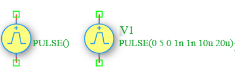

.. _vpulse_source:

Pulse Voltage Source
====================

The **Pulse Voltage Source** is an independent time-varying voltage source in the DSpice Sources library. It generates a pulsed voltage waveform with configurable rise time, fall time, pulse width, and period. It is essential for digital circuit simulation, switching analysis, and transient testing of analog circuits. It leverages the ngspice ``PULSE`` function within the ``V`` source model.

Symbol
------

The schematic symbol for the Pulse Voltage Source follows the IEEE/ANSI standard representation. It consists of a yellow circle containing a blue pulse waveform symbol and a polarity indicator (+) at the top terminal.

Description
-----------

A Pulse voltage source produces a time-varying rectangular or trapezoidal voltage waveform defined by initial value, pulsed value, delay, rise time, fall time, pulse width, and period. Key characteristics include:

- **Pulsed Output:** Generates a periodic voltage waveform that switches between two levels.
- **Configurable Parameters:** Supports initial value, pulsed value, delay time, rise time, fall time, pulse width, and period.
- **Digital Simulation Role:** Commonly used to model clock signals, data streams, and switching voltages in digital and mixed-signal circuits.
- **Transient Analysis:** Essential for observing circuit behavior during switching events, including rise/fall times and propagation delays.

The Pulse voltage source is widely used in digital logic testing, power electronics switching, PWM signal generation, and clock distribution analysis.

Netlist Format
--------------

In the SPICE netlist generated by DSpice, the Pulse voltage source is represented using the following syntax:

.. code-block:: text

   V<name> <node+> <node-> PULSE(V1 V2 Td Tr Tf Pw Per)

Where:

- ``V<name>``: Unique identifier starting with 'V' (e.g., V1, V_CLK, V_PWM).
- ``<node+>``: Positive terminal node number or name.
- ``<node->``: Negative terminal node number or name.
- ``PULSE(...)``: Keyword specifying pulsed waveform with the following parameters:
  - ``V1``: Initial voltage value in Volts (before the pulse starts).
  - ``V2``: Pulsed voltage value in Volts (the peak value during the pulse).
  - ``Td``: Delay time in seconds before the first pulse starts (default: 0).
  - ``Tr``: Rise time in seconds (time to transition from V1 to V2, default: simulation timestep).
  - ``Tf``: Fall time in seconds (time to transition from V2 to V1, default: simulation timestep).
  - ``Pw``: Pulse width in seconds (duration at V2 level).
  - ``Per``: Period in seconds (total time for one complete cycle).

Examples
~~~~~~~~

**Example 1: Basic Pulse Voltage Source**

The image above shows a Pulse voltage source configured as ``PULSE(0 5 0 1n 1n 10u 20u)``:

.. code-block:: text

   V1 1 0 PULSE(0 5 0 1n 1n 10u 20u)

This generates:
- **Initial Value:** 0 V (no voltage before pulse)
- **Pulsed Value:** 5 V (peak voltage during pulse)
- **Delay:** 0 s (pulse starts immediately)
- **Rise Time:** 1 ns (fast transition from 0 to 5 V)
- **Fall Time:** 1 ns (fast transition from 5 V to 0)
- **Pulse Width:** 10 µs (duration of high state)
- **Period:** 20 µs (total cycle time, giving 50% duty cycle)
- **Frequency:** f = 1/Per = 1/20µ = 50 kHz

The resulting waveform is a square wave with 5 V peak amplitude and 50 kHz frequency. This is a typical digital logic signal (TTL/CMOS compatible).

**Example 2: Clock Signal with Non-Zero Baseline**

.. code-block:: text

   V_CLK vdd gnd PULSE(1 3.3 1u 5n 5n 50n 100n)

This generates:
- **Initial Value:** 1 V (baseline voltage)
- **Pulsed Value:** 3.3 V (peak voltage)
- **Delay:** 1 µs (pulse starts after 1 µs)
- **Rise Time:** 5 ns
- **Fall Time:** 5 ns
- **Pulse Width:** 50 ns
- **Period:** 100 ns (10 MHz clock frequency)
- **Duty Cycle:** 50%

**Example 3: PWM Signal with Variable Duty Cycle**

.. code-block:: text

   V_PWM load gnd PULSE(0 12 0 10n 10n 25u 100u)

This generates:
- **Initial Value:** 0 V
- **Pulsed Value:** 12 V
- **Delay:** 0 s
- **Rise Time:** 10 ns
- **Fall Time:** 10 ns
- **Pulse Width:** 25 µs
- **Period:** 100 µs (10 kHz frequency)
- **Duty Cycle:** 25% (pulse is high for 25% of the period)

The voltage waveform is calculated as:

.. math::

   V(t) = \begin{cases} 
   V_1 & \text{for } t < T_d \\
   V_1 + (V_2 - V_1) \times \frac{t - T_d}{T_r} & \text{for } T_d \leq t < T_d + T_r \\
   V_2 & \text{for } T_d + T_r \leq t < T_d + T_r + P_w \\
   V_2 - (V_2 - V_1) \times \frac{t - T_d - T_r - P_w}{T_f} & \text{for } T_d + T_r + P_w \leq t < T_d + T_r + P_w + T_f \\
   V_1 & \text{for } T_d + T_r + P_w + T_f \leq t < T_d + Per \\
   \end{cases}

repeating with period ``Per``.

This format ensures full compatibility with ngspice and allows seamless integration into larger circuit netlists.

Advanced Parameters & Symbol Modification
-----------------------------------------

DSpice supports advanced simulation studies through optional parameters that can be added directly to the component symbol. This feature allows users to customize source behavior without altering the global model library.

Adding Series Resistance (Rser)
~~~~~~~~~~~~~~~~~~~~~~~~~~~~~~~

To model a non-ideal voltage source with internal resistance, you can modify the Vpulse symbol to expose the ``Rser`` parameter:

1. **Open Symbol Editor:** Right-click the Pulse Voltage Source symbol in your schematic and select "Edit Symbol" or access it via the Sources library manager.
2. **Add Parameter:** In the symbol properties panel, add a new parameter field named ``Rser``.
3. **Map to Netlist:** Ensure this parameter is mapped to the SPICE ``Rser`` attribute in the netlist generation settings.
4. **Save & Use:** Save the modified symbol. When placed in a schematic, you can now enter a specific internal resistance value directly in the component's property dialog.

The effective output voltage becomes:

.. math::

   V_{out} = V_{pulse}(t) - I_{load} \times R_{series}

Where :math:`I_{load}` is the current drawn by the circuit.

Use Cases
~~~~~~~~~

- **Digital Logic Testing:** Simulating clock signals and data streams for testing digital circuits, flip-flops, and microcontrollers.
- **PWM Control:** Generating pulse-width modulated voltages for motor control, LED dimming, and power regulation.
- **Switching Power Supplies:** Modeling switching voltages in buck, boost, and flyback converters.
- **Transient Response:** Observing how circuits respond to sudden voltage changes, including ringing, overshoot, and settling time.
- **EMI Analysis:** Studying electromagnetic interference caused by fast voltage transitions in high-speed circuits.
- **Gate Drive Simulation:** Modeling gate drive signals for MOSFETs and IGBTs in power electronics applications.
