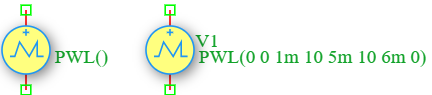

.. _vpwl_source:

Piecewise Linear Voltage Source
================================

The **Piecewise Linear (PWL) Voltage Source** is an independent time-varying voltage source in the DSpice Sources library. It generates a waveform defined by a series of time-voltage coordinate pairs, allowing users to create arbitrary voltage waveforms by linearly interpolating between specified points. It leverages the ngspice ``PWL`` function within the ``V`` source model.

Symbol
------

The schematic symbol for the PWL Voltage Source follows the IEEE/ANSI standard representation.

Description
-----------

A PWL voltage source produces a time-varying waveform defined by a sequence of (time, voltage) coordinate pairs. The source linearly interpolates between consecutive points, creating a piecewise linear approximation of any desired waveform. Key characteristics include:

- **Arbitrary Waveforms:** Can model any voltage waveform by specifying sufficient coordinate points.
- **Linear Interpolation:** Voltage values between specified points are calculated by linear interpolation.
- **Flexible Definition:** Supports as many time-voltage pairs as needed for accurate waveform representation.
- **Realistic Modeling:** Ideal for modeling measured or experimentally obtained voltage waveforms.

The PWL voltage source is widely used in modeling real-world voltage profiles, sensor outputs, custom test stimuli, and complex signal generation.

Netlist Format
--------------

In the SPICE netlist generated by DSpice, the PWL voltage source is represented using the following syntax:

.. code-block:: text

   V<name> <node+> <node-> PWL(t1 V1 t2 V2 t3 V3 ...)

Where:

- ``V<name>``: Unique identifier starting with 'V' (e.g., V1, V_PWL, V_CUSTOM).
- ``<node+>``: Positive terminal node number or name.
- ``<node->``: Negative terminal node number or name.
- ``PWL(...)``: Keyword specifying piecewise linear waveform with pairs of time and voltage values:
  - ``t1, t2, t3, ...``: Time points in seconds (must be in ascending order).
  - ``V1, V2, V3, ...``: Voltage values in Volts at the corresponding time points.

The source requires an even number of parameters (time-voltage pairs). At least two pairs (four parameters) are needed to define a waveform.

Examples
~~~~~~~~

**Example 1: Trapezoidal Voltage Pulse**

The image above shows a PWL voltage source configured as ``PWL(0 0 1m 10 5m 10 6m 0)``:

.. code-block:: text

   V1 1 0 PWL(0 0 1m 10 5m 10 6m 0)

This generates a trapezoidal waveform:
- **t = 0 ms:** V = 0 V (starting point)
- **t = 1 ms:** V = 10 V (linear rise from 0 to 10V in 1ms)
- **t = 5 ms:** V = 10 V (constant voltage for 4ms)
- **t = 6 ms:** V = 0 V (linear fall from 10V to 0 in 1ms)

The resulting waveform is a trapezoidal pulse with:
- **Rise time:** 1 ms
- **Flat top duration:** 4 ms (from 1ms to 5ms)
- **Fall time:** 1 ms
- **Total duration:** 6 ms
- **Peak voltage:** 10 V

**Example 2: Sensor Output Profile**

.. code-block:: text

   V_SENSOR out gnd PWL(0 0 100m 2.5 200m 2.5 300m 4.5 400m 4.5 500m 0)

This generates a stepped sensor output:
- **0-100ms:** Rise from 0V to 2.5V
- **100-200ms:** Hold at 2.5V
- **200-300ms:** Rise from 2.5V to 4.5V
- **300-400ms:** Hold at 4.5V
- **400-500ms:** Fall from 4.5V to 0V
- **Application:** Modeling a multi-stage sensor response curve

**Example 3: Power Supply Ramp-up**

.. code-block:: text

   V_DD vdd gnd PWL(0 0 10m 1.8 11m 3.3 12m 3.3)

This generates a power supply ramp-up sequence:
- **t = 0ms:** V = 0 V (power off)
- **t = 10ms:** V = 1.8 V (first rail stabilized)
- **t = 11ms:** V = 3.3 V (second rail stabilized)
- **t = 12ms:** V = 3.3 V (steady state)
- **Application:** Modeling sequential power supply initialization in multi-rail systems

The voltage waveform is calculated by linear interpolation between consecutive points:

.. math::

   V(t) = V_k + \frac{V_{k+1} - V_k}{t_{k+1} - t_k} \times (t - t_k)

for :math:`t_k \leq t \leq t_{k+1}`, where :math:`k` is the index of the current segment.

For :math:`t > t_{last}`, the voltage remains constant at :math:`V_{last}`.

This format ensures full compatibility with ngspice and allows seamless integration into larger circuit netlists.

Advanced Parameters & Symbol Modification
-----------------------------------------

DSpice supports advanced simulation studies through optional parameters that can be added directly to the component symbol. This feature allows users to customize source behavior without altering the global model library.

Adding Series Resistance (Rser)
~~~~~~~~~~~~~~~~~~~~~~~~~~~~~~~

To model a non-ideal voltage source with internal resistance, you can modify the Vpwl symbol to expose the ``Rser`` parameter:

1. **Open Symbol Editor:** Right-click the PWL Voltage Source symbol in your schematic and select "Edit Symbol" or access it via the Sources library manager.
2. **Add Parameter:** In the symbol properties panel, add a new parameter field named ``Rser``.
3. **Map to Netlist:** Ensure this parameter is mapped to the SPICE ``Rser`` attribute in the netlist generation settings.
4. **Save & Use:** Save the modified symbol. When placed in a schematic, you can now enter a specific internal resistance value directly in the component's property dialog.

The effective output voltage becomes:

.. math::

   V_{out} = V_{pwl}(t) - I_{load} \times R_{series}

Where :math:`I_{load}` is the current drawn by the circuit.

Use Cases
~~~~~~~~~

- **Sensor Modeling:** Simulating realistic sensor output voltage profiles with varying signal levels.
- **Power Supply Sequencing:** Modeling multi-rail power supply initialization with specific timing requirements.
- **Custom Test Stimuli:** Creating arbitrary voltage waveforms for circuit testing and characterization.
- **Measured Data Import:** Reproducing experimentally measured voltage waveforms by importing time-voltage data points.
- **Digital Signal Generation:** Modeling complex digital waveforms with specific rise/fall times and hold periods.
- **Audio Signal Processing:** Simulating envelope followers and amplitude modulation profiles.
- **Control Systems:** Modeling reference voltage profiles for feedback control loops.

.. note::
   Time points must be specified in strictly ascending order. Duplicate or decreasing time values will cause simulation errors.
   
   For waveforms requiring high accuracy, use more coordinate points in regions where the voltage changes rapidly.
  